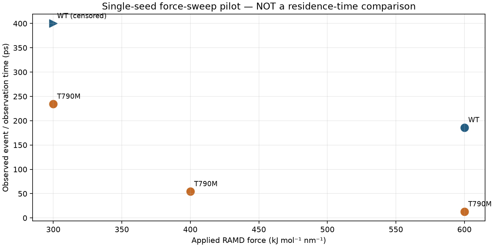
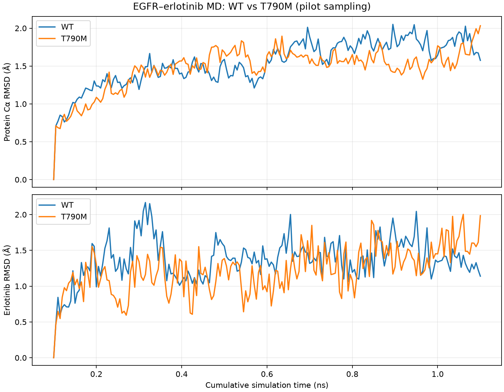
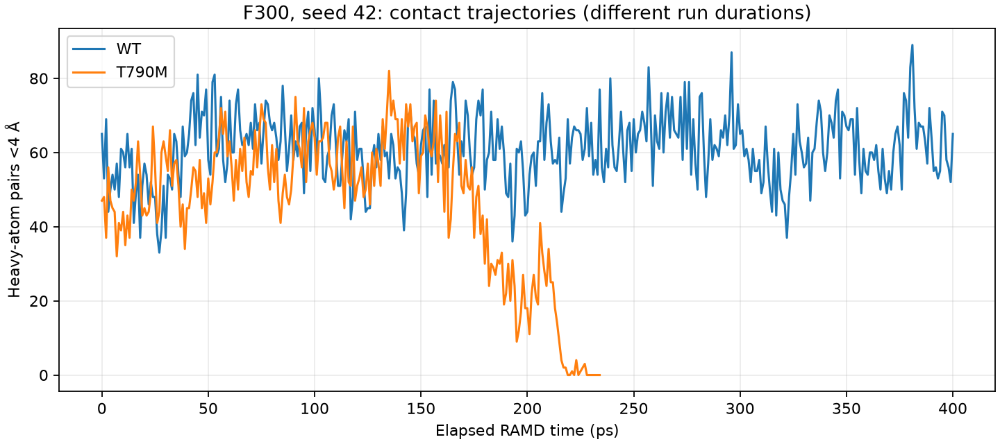

# KinaseDock-3D: EGFR–Erlotinib Docking, MD and RAMD Pilot

**Independent computational research-software and skills-demonstration project** · Version 1.0.0 (pilot)

This project documents a practical workflow for **molecular docking, explicit-solvent molecular dynamics (MD), and Random Acceleration Molecular Dynamics (RAMD)** using EGFR–erlotinib complexes. It examines **EGFR WT and single T790M** as a methodological example. The focus is on implementation, structural quality control, detecting *force-assisted ligand exit*, and documenting limitations—not on estimating experimental binding rates.

> **Scientific boundary:** RAMD exit times below are biased by an imposed force. They are **not** equilibrium residence times, measured `koff` values, a statistical τRAMD comparison, or evidence of clinical erlotinib resistance. Each force/target condition has **one observed trajectory (seed 42)**.

## What was implemented

- **Docking:** crystallographic redocking of erlotinib (AQ4) into the EGFR ATP-binding site (PDB [1M17](https://www.rcsb.org/structure/1M17)), AutoDock Vina multi-seed pose checks, ligand RMSD and contact inspection.
- **MD:** Amber-family protein parameters, GAFF2/AM1-BCC ligand parameters, TIP3P water, approximately 0.15 M salt, minimized and equilibrated WT/T790M systems followed by 1-ns unrestrained CUDA-accelerated GROMACS MD.
- **RAMD:** HITS-MCM [GROMACS-RAMD](https://github.com/HITS-MCM/gromacs-ramd) development build, force calibration, exit-event parsing, right-censored observations, PBC-aware atom-contact checks and checkpoint validation.

## Research relevance: computational kinase drug discovery

This project demonstrates **computational chemistry and structure-based drug discovery** methods in a **protein kinase / kinase inhibitor** case study. EGFR (epidermal growth factor receptor) and the ATP-site inhibitor erlotinib provide a concrete model for evaluating **protein–ligand interactions**, **ligand binding-pocket dynamics**, **molecular docking**, **molecular dynamics simulations**, and **force-assisted ligand dissociation pathways**.

| Demonstrated skill / keyword | Evidence in this pilot |
|:--|:--|
| **Molecular docking; structure-based modeling; kinase inhibitors** | AutoDock Vina multi-seed erlotinib redocking to EGFR crystal structure 1M17 and pose RMSD checks |
| **Computational chemistry; structural biology; protein kinases** | EGFR WT/T790M structure preparation, force-field setup, solvated molecular dynamics |
| **Protein–ligand interactions; ligand binding** | Heavy-atom contact counts, minimum distances, aligned ligand RMSD and structural QC |
| **Binding kinetics methodology; dissociation pathways; enhanced sampling** | GROMACS-RAMD force sweep, event detection, PBC checks and right-censored trajectory reporting |
| **Python programming; scientific data analysis; reproducible visualization** | CSV-based analysis and Matplotlib plotting script in `scripts/`; original MD/RAMD plots in `figures/` |
| **Drug-resistance context; mutation-aware comparison** | EGFR WT compared with single T790M as a methodological case study **without** validated resistance prediction |
| **Open-science documentation and data provenance** | Public event-summary CSV, code, QC figures, methods and explicit limitations; **not** a fully FAIR-curated benchmark |

**Important scope distinction:** This pilot uses an **ATP-binding-site inhibitor**. It does **not** implement allosteric modulation, polypharmacology prediction, non-ATP kinase-interface design, peptide/peptidomimetic design, deep learning, PyTorch, RDKit descriptor pipelines, trained resistance-prediction models, or decision-support dashboards. Those topics are scientifically relevant to future kinase-drug-discovery work, but listing them as completed results here would be inaccurate.

The **RAMD exit times are force-biased methodological observations**, not unbiased ligand residence times or experimentally validated `koff` estimates. Original docking/MD input and trajectory files are not yet fully deposited, so atomistic reproducibility remains limited.

## Pilot RAMD results (seed 42)

| EGFR system | Applied RAMD force (kJ mol⁻¹ nm⁻¹) | Observed RAMD time (ps) | Interpretation |
|:--|--:|--:|:--|
| WT | 600 | 186.0 | Exit event recorded; no final <4 Å contacts |
| T790M | 600 | 13.0 | Exit event recorded; no final <4 Å contacts |
| T790M | 400 | 54.4 | Exit event recorded; no final <4 Å contacts |
| WT | 300 | **≥400.0** | No exit by run limit; **right-censored** |
| T790M | 300 | 234.3 | Exit event recorded; no final <4 Å contacts, but **3 atom pairs <10 Å** at final checkpoint |

### RAMD force-sweep figure

> The WT F300 result is **right-censored at 400 ps**; the plot is an exploratory visualization, not a statistical estimate of equilibrium residence time.

Exit time is `(exit_step - 550000) × 0.002 ps`. The RAMD algorithmic criterion used a **4.0 nm exit threshold**; this is not the minimum distance between every protein and ligand atom.

**Final checkpoint qualification for T790M/F300:** time 1334.302 ps, minimum protein–ligand heavy-atom distance 0.9374 nm, three pairs within 1 nm, all with zero periodic-image shift in the examined snapshot. This shows **pocket departure with residual proximity**, not complete disappearance of nonbonded interactions.

## Short MD structural quality control

| System | Mean protein Cα RMSD (Å) | Mean protein-aligned ligand RMSD (Å) | Mean heavy-atom pairs within 4 Å |
|:--|--:|--:|--:|
| WT | 1.539 | 1.367 | 55.985 |
| T790M | 1.468 | 1.225 | 55.463 |

### Molecular dynamics RMSD

Each analysis included 201 recorded frames. **One nanosecond is a short pilot, not an equilibrium/convergence demonstration.**

### Ligand-contact changes during RAMD at F300

The molecular-contact plots depict the **force-assisted** trajectories, not spontaneous ligand dissociation.

## Reproduce plots and inspect data

The repository includes the original plotted figures in [`figures/`](figures), the workstation-generated [`data/ramd_results.csv`](data/ramd_results.csv), and a small, explicitly labeled table in [`data/pilot_event_summary.csv`](data/pilot_event_summary.csv). Full run-specific plots, XVG series, MD/RAMD parameter files and more scripts can be copied from the original Y700 working directory using the accompanying local publication kit. **Large trajectories, checkpoint binaries and force-field files are deliberately not committed here.**

For scientific interpretation see [Methods](docs/METHODS.md), [Data provenance](docs/DATA_PROVENANCE.md) and [Limitations](docs/LIMITATIONS.md). The repo currently documents the pilot; do not claim that the small summary CSV alone can reproduce atomistic simulations.

## Software

[AutoDock Vina](https://vina.scripps.edu/) · [GROMACS](https://www.gromacs.org/) · [GROMACS-RAMD](https://github.com/HITS-MCM/gromacs-ramd) · [τRAMD](https://github.com/HITS-MCM/tauRAMD)

## Citation and release

**Published GitHub release:** [v1.0.0 — EGFR Docking, MD & RAMD](https://github.com/sanatat/KinaseDock-3D/releases/tag/v1.0.0). **Zenodo DOI:** [10.5281/zenodo.24134746](https://doi.org/10.5281/zenodo.24134746) (record identifier supplied by repository owner).

Maintainer: **Sana Tat**. See [`CITATION.cff`](CITATION.cff). This is a **research-software / computational pilot**, not a peer-reviewed article. A Zenodo DOI should be inserted **only after** archiving an actual GitHub Release. [Publishing guide](docs/PUBLISH_GITHUB_ZENODO.md).
